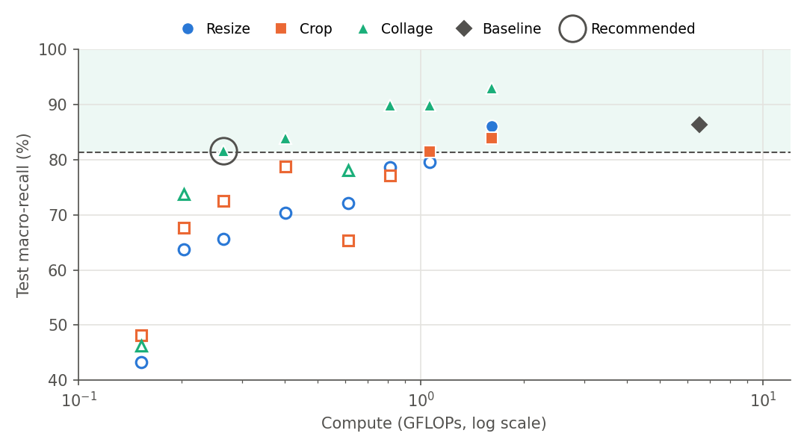
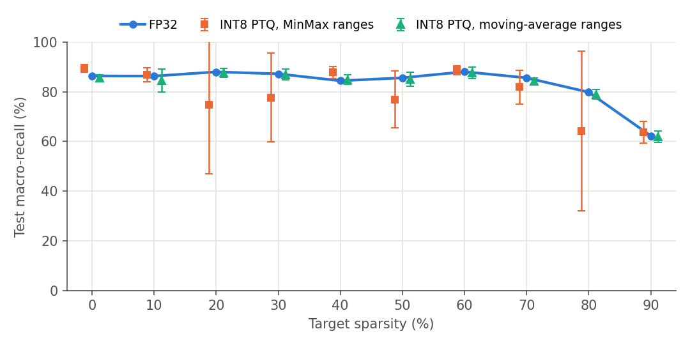

<h1 align="center">Pruning Missed Detections</h1>
<p align="center"><b>How far can a driver-monitoring detector be shrunk before it misses drowsiness and distraction?</b><br>
YOLO11n, pruning, INT8 quantization and smaller inputs, scored by macro-recall on drivers the model has never seen.</p>

<p align="center">
<a href="https://github.com/IamOumarIbrahim/pruning-missed-detection/raw/main/paper/main.pdf"></a>
</p>

<p align="center">


</p>



<p align="center"><i>Shaded band: at or above the 81.4% safety floor. Hollow markers fail it. The ring marks the
cheapest configuration that passes.</i></p>

## How it works

```mermaid
flowchart LR
    A([DMD frames<br>8:3:3 drivers]):::in --> B[Input<br>resize, crop, collage]:::geo
    B --> C[YOLO11n<br>channel pruning]:::model
    C --> D[INT8<br>PTQ or QAT]:::model
    D --> E[Score at τ = 0.5<br>boxes mapped back]:::eval
    E --> F[Clip bootstrap<br>vs baseline]:::eval
    F --> G([Cheapest config<br>above the floor]):::out
    classDef in fill:#eef3fa,stroke:#1f4e9a,color:#14171c
    classDef geo fill:#f2c9a0,stroke:#c0752a,color:#14171c
    classDef model fill:#dbe5f4,stroke:#1f4e9a,color:#14171c
    classDef eval fill:#d7ecd9,stroke:#2e7d32,color:#14171c
    classDef out fill:#14285a,stroke:#14285a,color:#ffffff
```



## Results at a glance

All numbers come from the pipeline below; none are typed by hand.

| Question | Answer |
|---|---|
| What is the cheapest configuration that stays safe? | 160 px overlapping collage, 30% pruned, INT8 PTQ: **81.5% macro-recall at 0.27 GFLOPs and 2.1 MB**, 24.5× less compute and 4.8× less storage than the FP32 baseline (86.4%). It clears the 81.4% floor by just 0.1 pp, and every cheaper candidate fails |
| What gives the most recall for the compute? | 320 px collage with INT8 PTQ: **92.9% at 1.61 GFLOPs and 3.0 MB**, 4× less compute than the baseline and 6.5 pp *higher* recall (95% CI +0.9 to +13.6) |
| Where does pruning work? | At full resolution only. At 640 px YOLO11n holds the floor up to 70% channel sparsity; at 320 px and below the same sparsity fails, and the pick made on three validation drivers lost 12.6 pp on test |
| Crop or collage? | A static crop magnifies the face, so yawning improves, but it cuts 9% of phone-use boxes. The overlapping collage keeps both and wins at every resolution down to 160 px |
| Is INT8 stable? | Only with robust calibration. MinMax ranges made PTQ recall swing by up to 32 pp between seeds while mAP barely moved; moving-average ranges fix it |



## The paper

| File | Contents |
|---|---|
| [`paper/main.pdf`](paper/main.pdf) | Revised manuscript (ICAUC-72) |
| [`paper/main_highlighted.pdf`](paper/main_highlighted.pdf) | Same, with every change since the first submission in blue |
| [`paper/response/`](paper/response) | Response to the reviewers (PDF and LaTeX source) |
| [`docs/audit.md`](docs/audit.md) | How the numbers were checked and what changed from the first submission |

## Reproduce

```bash
git clone https://github.com/IamOumarIbrahim/pruning-missed-detection.git
cd pruning-missed-detection
pip install -r requirements.txt

python scripts/build_partitions.py      # crop, collage and resized inputs (needs DMD frames, see data/README.md)
python scripts/train.py baseline        # then: prune, input, ptq, qat, codesign --method collage --resolution 320 --sparsity 0
python scripts/evaluate.py              # inference once per model, cached in results/detections
python scripts/score.py                 # metrics at tau = 0.5 for every run
python scripts/profile_models.py        # parameters, GFLOPs, ONNX sizes
python scripts/report.py                # summary tables, bootstrap intervals, selection
python scripts/paper_assets.py          # LaTeX tables and figures for the paper
python scripts/build_paper.py           # clean and highlighted PDFs
pytest tests
```

Every finished step is skipped on a re-run, so an interrupted pipeline resumes where it stopped.
QAT needs `nvidia-modelopt` (in `requirements.txt`). Checkpoints are not in git; evaluation needs
`models/`, laid out as in `dms/runs.py`.

## Protocol

Subjects are split 8:3:3 (train, validation, test), so no driver appears in two splits. Every
model is scored on the same 3,213 test frames at one confidence threshold, τ = 0.5, with greedy
class-aware matching at IoU 0.5. Detections from a crop or collage are mapped back to the full
frame and matched to the visible part of each box, and a box the input removes counts as a miss.
Results are the mean ± SD over three seeds. Intervals come from a bootstrap over whole recording
clips, because the rare classes come from only five test clips each.

## Repository map

| Path | Contents |
|---|---|
| `dms/` | The library: data and input transforms, pruning, quantization, metrics, statistics |
| `scripts/` | One script per pipeline stage, listed above |
| `configs/experiment.yaml` | Every setting of the paper: splits, seeds, sparsities, crop and collage geometry |
| `results/tables/` | Per-run metrics (`runs.csv`), phase summaries, uncertainty, model costs |
| `paper/` | IEEE manuscript, PDFs and reviewer response; `generated/` holds the tables and figures written by the scripts |
| `data/` | Annotations and split lists; DMD frames are obtained separately |
| `tests/` | Metric, matching, coordinate-mapping and pruning-equivalence tests |

## Limits

The rare classes, yawning and hand over mouth, come from only five test clips each, so their recall
is uncertain and the intervals are wide. The recommended configuration was ranked on test results,
so it is a recommendation, not a validated selection, and it clears the floor only narrowly.

## Citation

```bibtex
@inproceedings{ibrahim2027codesign,
  title     = {Model Compression and Input Optimization Co-Design for Edge Driver Monitoring Systems},
  author    = {Ibrahim, Oumar Mamoun and bin Ishak, Mohamad Khairi and Abouelhamd, Ahmed Atef},
  booktitle = {Proc. ICAUC 2027},
  year      = {2027}
}
```

DMD frames belong to the Driver Monitoring Dataset and need its own licence (see [data/README.md](data/README.md)).
